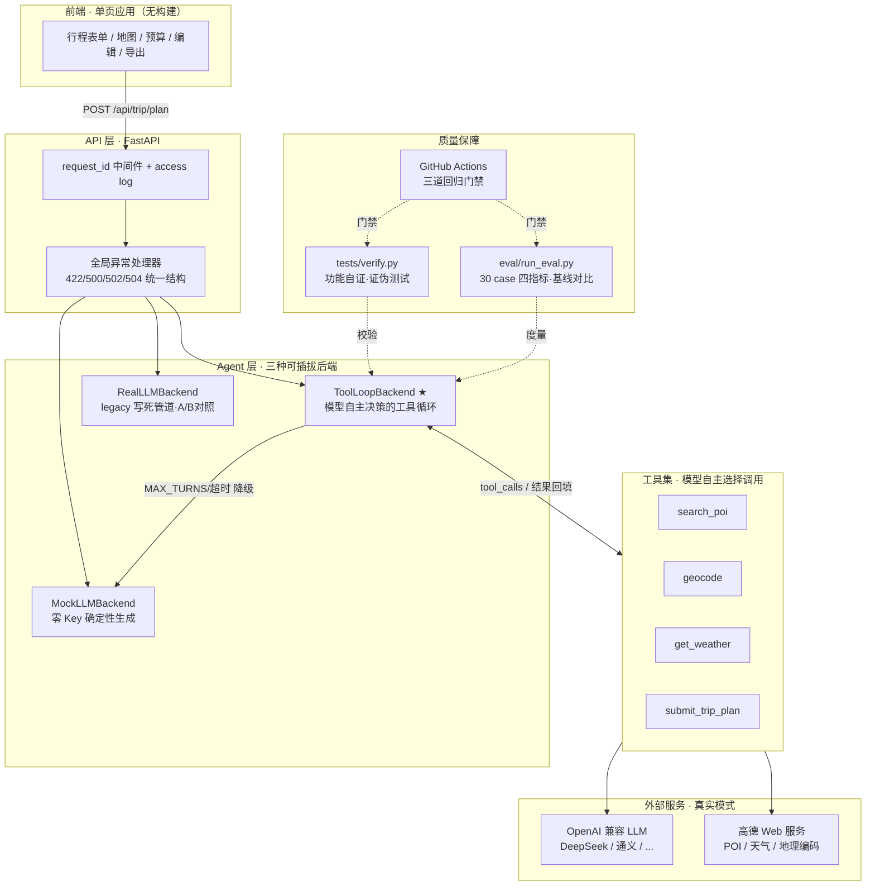

# 智能旅行助手（Travel Agent）

一个可写进简历的 Agent 项目：用户输入目的地 / 日期 / 偏好，自动生成含**景点、餐饮、酒店**的完整行程，并在地图上标注、计算预算、支持编辑与导出。

> 本项目以 Datawhale `hello-agents` 第 13 章为蓝图，但做了**可插拔后端 + 零 Key 可运行 + 工具循环 Agent**的改进，方便你先跑通再接真实服务。
>
> **v2（当前）**：真实模式已从「写死管道」升级为「模型自主决策的工具循环」——`ToolLoopBackend` 把
> `search_poi / geocode / get_weather / submit_trip_plan` 暴露给模型，`tool_choice=auto`，
> 由模型决定查什么、查几轮、何时提交，并带 MAX_TURNS 触顶降级、坏 JSON/工具异常兜底与防幻觉候选校验。
> 旧的写死管道保留在 `AGENT_MODE=legacy` 供 A/B 对照。

## 五大需求覆盖

| 需求 | 实现位置 |
|---|---|
| (1) 智能行程规划 | `llm_backends.py`：`MockLLMBackend`（零 Key 生成器）/ `RealLLMBackend`（高德取真实候选 + LLM function calling 规划） |
| (2) 地图可视化 | `docs/app.js`：`renderAmap()`（高德 JS API 真实地图）/ `renderSvgMap()`（零 Key 降级 SVG） |
| (3) 预算计算 | `Budget` 模型 + 前端 `renderBudget()`，编辑时实时重算 |
| (4) 行程编辑 | 前端删除 / 上下移，触发 `recomputeBudget()` + 重绘地图 |
| (5) 导出 PDF/图片 | `html2canvas` + `jsPDF` |
| (6) 天气查询 | 前端选「出发日期」→ 后端 `start_date` 透传 → mock 模式确定性生成每日天气；真实模式调用高德天气 API（`amap.weather`），按出发日偏移对齐，超免费预报范围自动降级 |

## 系统架构



> 图中 ★ 是本项目的核心改造点。可对照前文「相比教程的改进」逐项定位。

## 目录结构

```
travel-agent/
├── backend/                 # FastAPI + Pydantic + Agent 编排
│   ├── models.py            # 数据模型（Location→…→TripPlan）
│   ├── mock_data.py         # 零 Key 行程生成器（确定性随机）
│   ├── amap.py              # 高德 Web 服务封装（POI/天气/地理编码）
│   ├── llm_backends.py      # 后端抽象：Mock / RealLLMBackend（legacy 写死管道）
│   ├── tool_loop.py         # ★ v2 工具循环 Agent：模型自主决策 + 终止/兜底/防幻觉
│   ├── errors.py            # ★ 阶段0：类型化异常与统一错误码
│   ├── observability.py     # ★ 阶段0：JSON日志 + request_id
│   ├── app.py               # FastAPI 入口（POST /api/trip/plan）+ 全局异常处理
│   ├── requirements.txt
│   └── .env.example
├── tests/                   # 离线测试（零 Key / 零网络）
│   ├── test_concurrency.py     # 旧版并发抓取提速验证
│   ├── test_tool_loop.py       # ★ 工具循环：自主多轮 / 触顶降级 / 异常兜底
│   ├── test_observability.py   # ★ 阶段0：错误码 / JSON日志 / request_id
│   └── verify.py               # ★ 一键自证脚本
├── eval/                    # 阶段2 离线评测集
│   ├── cases.json / run_eval.py / baseline.json / report.md
└── docs/                    # 单页应用（无构建步骤，同时作为 GitHub Pages 发布目录）
    ├── index.html           # 动态加载高德 JS API（有 key 才加载）
    ├── app.js               # 规划/地图/预算/编辑/导出（后端不可达时自动降级）
    ├── mock.js              # 前端内置 mock 生成器（GitHub Pages 无后端时演示用）
    ├── config.js            # 高德 Web Key 配置（占位降级）
    └── styles.css
```

> **在线演示**：GitHub Pages 从 `docs/` 构建，地址 https://wyf0613.github.io/travel-agent/ 。静态站点无后端时，`app.js` 自动降级到 `mock.js`，行程/地图/预算/编辑/导出功能均可完整演示（数据为内置示例）。本地运行时若后端已启动，则优先使用真实后端。

## 快速运行（零 Key，5 分钟）

```bash
# 1) 后端（已装好依赖）
cd backend
.venv/Scripts/python -m uvicorn app:app --reload --port 8000   # 若 8000 被占用可换端口，如 --port 8899

# 2) 前端：用任意静态服务器打开
cd ../docs
python -m http.server 8080
# 浏览器访问 http://127.0.0.1:8080
```

打开后填「北京 / 3 天 / 历史,美食」点生成，即可看到行程、**SVG 地图**、预算、编辑与导出（零 Key 也能完整演示）。

> **端口对齐提醒**：前端 `docs/app.js` 第 5 行的 `API` 常量写死了后端地址（默认 `http://127.0.0.1:8000/api/trip/plan`）。**若启动后端时改了端口（例如本会话临时用 `8899`，是因为 8000 被上次残留进程占用、且沙箱无法杀进程），必须同步把 `app.js` 里的端口改成相同值**，否则前端请求打不到后端。

## 切换到真实模式（接 LLM + 高德地图）

1. 安装真实模式依赖：`pip install -r requirements.txt`（含 `openai`、`requests`）
2. `cp .env.example .env`
3. 申请两类高德 Key（[高德开放平台](https://lbs.amap.com/)，均有免费配额）：
   - **Web 服务** key → 填入 `.env` 的 `AMAP_API_KEY`（后端调用 POI / 天气 / 地理编码，**服务端**，勿泄露）
   - **Web 端(JS API)** key → 填入 `docs/config.js` 的 `AMAP_WEB_KEY`；JS API 2.0 安全密钥 → `AMAP_SECURITY_CODE`
4. 配置 LLM：在 `.env` 填 `LLM_API_KEY / LLM_BASE_URL / LLM_MODEL_ID`（**OpenAI 兼容接口**，可换 DeepSeek / 通义 / 本地 vLLM）
5. `.env` 设 `AGENT_MODE=real`，重启后端
6. 刷新前端页面，地图自动从 SVG 切换为高德真实地图

**真实模式数据流（v2 工具循环）**：
`用户请求 → LLM（tools=auto，自主决策）→ [search_poi / geocode / get_weather] → 结果回填 messages → LLM 再决策 → … → submit_trip_plan → 校验+回填真实经纬度/天气 → TripPlan`。
模型自己决定查什么、查几轮；代码只负责执行工具、施加终止条件与兜底。可用环境变量调节：`AGENT_MAX_TURNS`（默认 6）、`AGENT_TIMEOUT`（秒，默认 40）。

> 想对比旧版写死管道，把 `AGENT_MODE` 设为 `legacy` 即可（一次性固定查 3 路 POI + 强绑提交）。

## 相比教程的改进（简历可写的点）

- **★ 工具循环 Agent（质变）**：真实模式用 `ToolLoopBackend` 实现标准的
  `LLM 决策 → 执行工具 → 结果回填 → 再决策` 循环，`tool_choice=auto`，模型自主决定检索策略，
  不再是「代码写死查询 + 强迫模型填空」的伪 Agent。这是与教程最大的不同。
- **★ 终止条件与失败兜底**：MAX_TURNS 上限 + 全局超时，触顶自动降级为可用计划；
  坏 JSON / 工具异常 / 校验失败都会转成 tool message 回填让模型纠错重试，链路不会因单点失败崩掉。
- **★ 防幻觉候选校验**：submit 时校验模型引用的 POI 是否真的来自 search_poi 结果，
  未命中则拒绝并要求重查——对应评测集的「候选命中率」指标。
- **可观测 trace**：每轮记录 turn / tool / args / degraded，可直接喂给离线评测集统计平均轮次与工具命中。
- **★ 结构化日志 + request_id**：JSON 行日志可被 ELK/Loki 采集；每个请求分配 request_id，
  贯穿 access log、Agent 每轮工具调用、错误响应体与 `X-Request-ID` 响应头，出问题能按 ID 串联全链路。
- **★ 类型化错误码**：配置缺失→500 `CONFIG_ERROR`、参数错→422、上游超时→504、上游错误→502，
  统一 `{"error": {"code", "message", "request_id"}}` 结构（改造前所有异常都被拍成 400）。
- **后端可插拔 + A/B 对照**：mock / real（工具循环）/ legacy（旧写死管道）三种模式，依赖注入便于测试。
- **零 Key 可跑**：不申请任何 Key 即可演示完整链路，便于面试现场展示，不怕翻车。
- **function calling 约束输出**：用工具 schema 强制 LLM 输出合法结构，解决教程「自由吐 JSON 解析脆弱」的痛点。
- **真实数据驱动**：景点 / 酒店 / 经纬度 / 价格来自高德，而非模型凭空编造。
- **编辑实时联动**：增删 / 排序景点即时重算预算并重绘地图。
- **导出规避了教程的 Canvas 跨域坑**：SVG 地图天然无跨域问题，`html2canvas` 稳定。

## 测试与验证（全部零 Key / 零网络）

**一键自证（推荐）**：想独立检验阶段 1 的成果，不需要看任何说明文档，直接跑：

```bash
python tests/verify.py
```

它会打印 5 组可核对的证据：① 单元测试结果 ② 工具循环逐轮真实 trace（每轮选了什么工具/什么参数）
③ 证伪 A：限制 1 轮且模型不提交 → 必须降级 ④ 证伪 B：引用没搜过的 POI → 必须被拦截
⑤ 模式路由。全部通过时最后一行输出 `ALL_VERIFICATIONS_PASSED`，任何一项失败则是 `SOME_VERIFICATIONS_FAILED`。

单项测试：

```bash
python tests/test_tool_loop.py      # 工具循环：自主多轮收敛 / 触顶降级 / 坏JSON+工具异常兜底
python tests/test_observability.py  # 阶段0：错误码分类(422/500/504) + JSON日志 + request_id
python tests/test_concurrency.py    # legacy 模式并发抓取提速验证
python -m pytest tests/ -q          # 统一跑（当前 8 passed）
```

`test_tool_loop.py` 用 FakeLLM（按脚本逐轮返回 tool_calls）+ FakeAmap 注入后端，验证「决策权真的在模型手里」：
断言工具调用顺序由脚本决定、`tool_choice=auto`、真实坐标回填、MAX_TURNS 触顶降级、异常回填后能自愈收敛。

## 阶段 2：离线评测集（已完成）

30 条 case（`eval/cases.json`），覆盖热门/冷门城市、多天数、0 偏好、无预算，以及幻觉引用、坏 schema、只查不提交、坏 JSON 等故障注入。

```bash
python eval/run_eval.py                 # 跑评测，输出指标表 + eval/report.md
python eval/run_eval.py --save-baseline # 把当前指标存为基线 baseline.json
python eval/run_eval.py --compare       # 与基线对比，做回归检测（指标回退会显示）
```

四项指标（当前基线）：

| 指标 | 数值 | 说明 |
|---|---|---|
| schema 通过率 | 100% | 输出能被 TripPlan 校验 |
| 幻觉拦截率 | 100% | 引用未搜索 POI 时被挡下 |
| 预算合规率 | 100% | 有预算约束时不超限 |
| 降级率 / 平均轮次 | 6.7% / 4.5 | 只查不提交的 case 按设计降级；工具循环效率 |

**诚实边界**：评测用 FakeLLM 模拟模型输出，度量的是**编排层在各类输入/故障下的正确性**，不是真实 LLM 的准确率（后者需配 Key 做 online 评测）。

**评测的真实收益**：首轮跑评测时 C21-C23（幻觉 case）失败，暴露出防幻觉逻辑的一个真实漏洞——某类候选池为空时会跳过拦截，让"压根没搜就编造"的幻觉绕过检查。已修复（`_unresolved_refs`），并重跑确认 30/30 通过。这正是评测集相对单测的价值：用规模化场景发现边角 bug。

## 并发优化（legacy 模式，已完成）

旧版 3 路高德 POI 搜索 + 地理编码原本是**串行阻塞 I/O**（教程原版 10–30s），已改用 `ThreadPoolExecutor` 并发（`RealLLMBackend._fetch_candidates`）。v2 工具循环由模型逐轮决策，不再固定并发查询，但旧实现与测试保留在 `legacy` 模式供对照。

## CI 回归门禁（阶段 3 · 已完成）

`.github/workflows/ci.yml`：每次 push / PR 自动跑三道门禁——
① `pytest tests/ -q` ② `python tests/verify.py` ③ `python eval/run_eval.py --compare`。
任一失败则 CI 红。前置 `.gitignore` 已排除 `.env` / `.venv`，避免密钥与巨型目录被提交。

> 说明：Gate 3 的 `--compare` 目前负责**输出指标对比报告**（指标回退会直观显示），
> 真正的硬失败由 Gate 1/2 保证。如果想要"指标回退即红灯"，可后续让 `--compare` 在回退时返回非零退出码。

## 已完成阶段

- 阶段 1：工具循环 Agent + 终止/兜底/防幻觉 + 可注入测试
- 阶段 2：30 条离线评测集 + 四指标 + 基线/回归对比
- 阶段 0（必做项）：结构化日志 + request_id + 类型化错误码（配置集中/调用超时分别为可选/已在阶段1覆盖，未重复做）
- 阶段 3（必做项）：GitHub Actions 三道回归门禁 + 系统架构图（Docker/云端部署对简历项目不必要，未做）

**四阶段企业级改造至此收尾。**

## 下一步可扩展（可选增强，非必要）

- 让 `run_eval.py --compare` 在指标回退时返回非零退出码，使 Gate 3 成为硬门禁。
- 真实地图路线规划（高德驾车 / 步行 API）、多智能体分工。
- online 评测：配真实 Key 后，用同上 30 条 case 度量真实模型准确率，与离线基线互补。
- `rag.py` 仍是空壳：POI 候选仅几十条，明文拼接已够，**当前不急需 RAG**；待评测显示长 description 幻觉成瓶颈再接。
